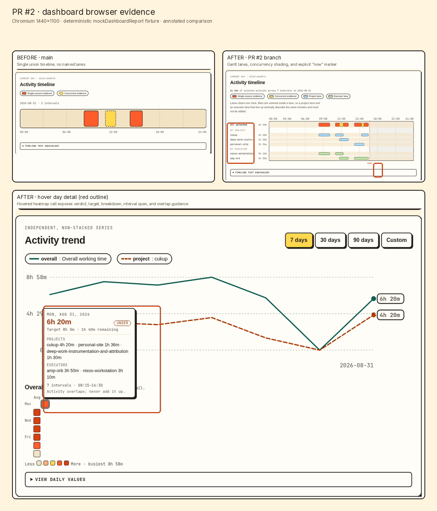

# E2E evidence: dashboard Gantt lanes and day-detail cards

## Environment

- PR: [#2](https://github.com/zainfathoni/cukup/pull/2)
- Branch: `feat/dashboard-gantt-and-day-details`
- Commit: [`c2bcc11`](https://github.com/zainfathoni/cukup/commit/c2bcc11748769bb60338638e8e07ea4b61afbff8)
- Browser: Chromium 152.0.7977.82, headless, 1440 × 1100 viewport
- Surface: local static harness for the authenticated dashboard document and bundled client
- Baseline: the same harness from `origin/main`
- Fixture: `service/dashboard/mockDashboardReport`, 7-day range, Asia/Jakarta

## Summary

- Timeline passed. It named project and executor lanes. It kept the union row and concurrency shading. It marked the future with `now`.
- Day detail passed. Hover showed the date, verdict, target, breakdowns, interval span, and non-additive guidance.
- Console and network checks passed. There were no errors or failed requests after the local favicon loaded.

## Evidence

Load `/` in the harness. Hover the `Mon, Aug 31, 2026` heatmap cell. The fixture contains no customer data.

## Limits

This historical test covered local rendering and the bundled client. It did not test OAuth, live authentication, deployed routing, or report refresh.
