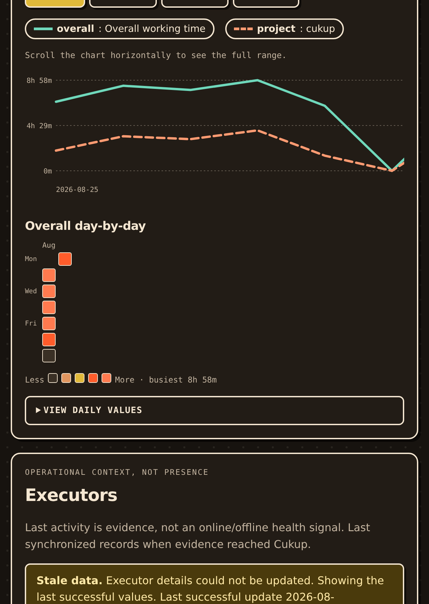
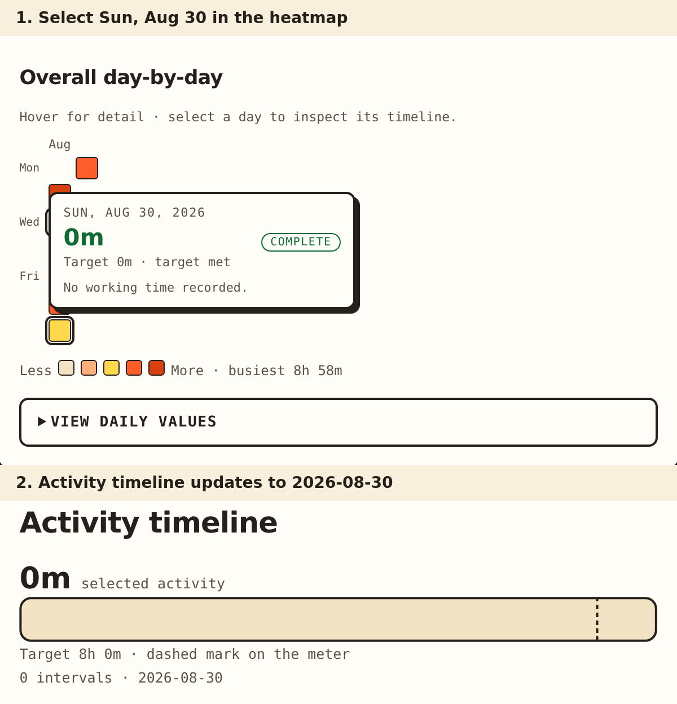

# E2E evidence: clickable heatmap dates

## Environment

- Baseline: [`8347939`](https://github.com/zainfathoni/cukup/commit/8347939ad90b3f706db3bbb081a8bee8d518f39f) (`origin/main` before this change)
- Candidate: local working tree
- Browser: Chrome for Testing 153.0.8010.36 through agent-browser 0.37.1
- Viewport: 640 × 900 CSS pixels at 2× scale, with desktop hover and fine pointer
- Surface: local harness with dashboard assets and deterministic report responses
- Fixture: `service/dashboard/mockDashboardReport`, 7-day range, Asia/Jakarta

## Summary

- Narrow hover passed. The baseline hid the detail below 56rem. The candidate showed the complete card.
- Pointer affordance passed. The candidate used a native `BUTTON` and `cursor: pointer` instead of `cursor: auto`.
- Date activation passed. Selecting `2026-08-30` refreshed that date and set `aria-pressed="true"`.
- The selection scrolled to the Activity timeline, focused its heading, and showed `0 intervals · 2026-08-30`.

## Before: narrow hover hides the detail

At 640px, the baseline hid the hovered final-day detail with `display: none`.

## After: narrow hover and pointer affordance

The candidate showed the card at the same width. Assertions found a `BUTTON`, `cursor: pointer`, `display: block`, and `visibility: visible`. Its accessible name was `Inspect Mon, Aug 31, 2026 in the activity timeline`.

## After: selecting a date activates its timeline

Selecting `2026-08-30` sent that date in the report request. The response focused the Activity timeline heading and showed the selected date.

## Limits

This historical local test covered rendering, the bundled client, and report selection. It did not test GitHub OAuth or production routing.
