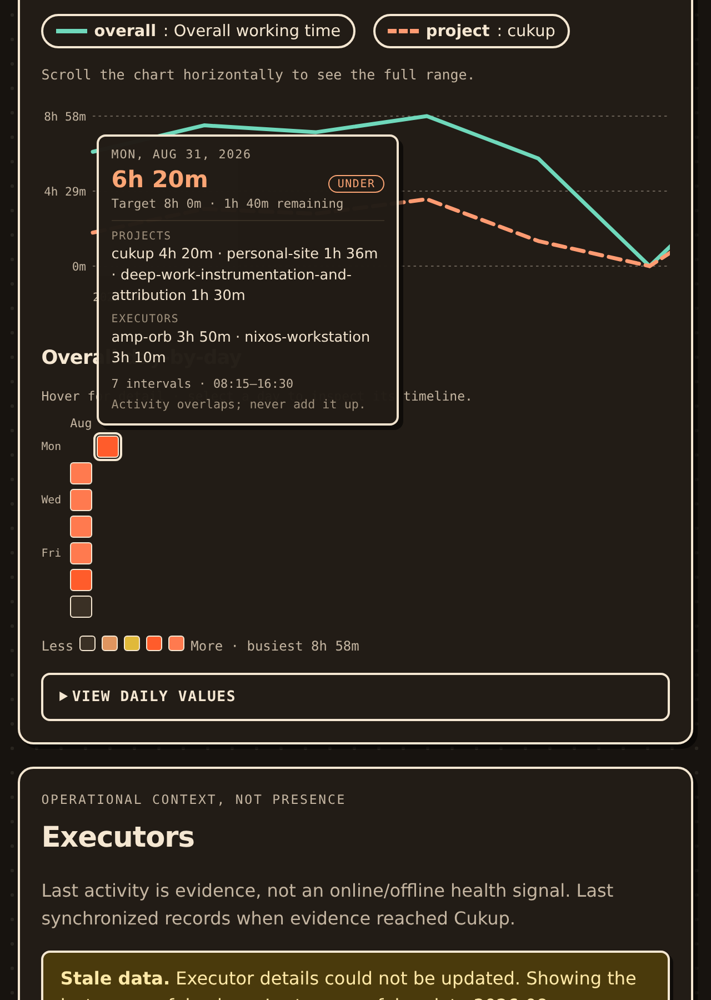

# E2E evidence: clickable heatmap dates

Environment:
- Baseline: `8347939ad90b3f706db3bbb081a8bee8d518f39f` (`origin/main` before this change)
- Candidate: local working tree
- Browser: Chrome for Testing 153.0.8010.36 through agent-browser 0.37.1
- Viewport: 640 × 900 CSS pixels at 2× device scale with desktop hover and fine-pointer capabilities
- Surface: local browser harness serving the dashboard document, stylesheet, bundled client, and deterministic report responses
- Fixture: `service/dashboard/mockDashboardReport`, 7-day range, Asia/Jakarta

## Summary

- Narrow-width hover regression: fixed. The baseline computes `display: none` for the detail card below the 56rem breakpoint; the candidate displays the complete card on hover.
- Pointer affordance: fixed. The baseline heatmap cell computes `cursor: auto`; the candidate is a native `BUTTON` and computes `cursor: pointer`.
- Date activation: passed. Selecting `2026-08-30` refreshes the report with that date, marks the cell `aria-pressed="true"`, scrolls to the Activity timeline, focuses its heading, and displays `0 intervals · 2026-08-30`.

## Before: narrow hover hides the detail

The final heatmap cell is hovered at 640px. No day-detail card is rendered, matching the baseline computed style `display: none`.

## After: narrow hover and pointer affordance

The same cell and viewport now display the existing day-detail card. Browser assertions identify the target as a `BUTTON`, report `cursor: pointer`, and report the card as `display: block` and `visibility: visible`. Its accessible name is `Inspect Mon, Aug 31, 2026 in the activity timeline`.

## After: selecting a date activates its timeline

Selecting the `2026-08-30` cell sends that date in the report request. After the response, the Activity timeline heading owns focus and the timeline visibly reports the selected date.

Limitations:
- This is a deterministic local browser test of the rendered dashboard, bundled client, and report-selection interaction. GitHub OAuth and deployed production routing were not exercised.
