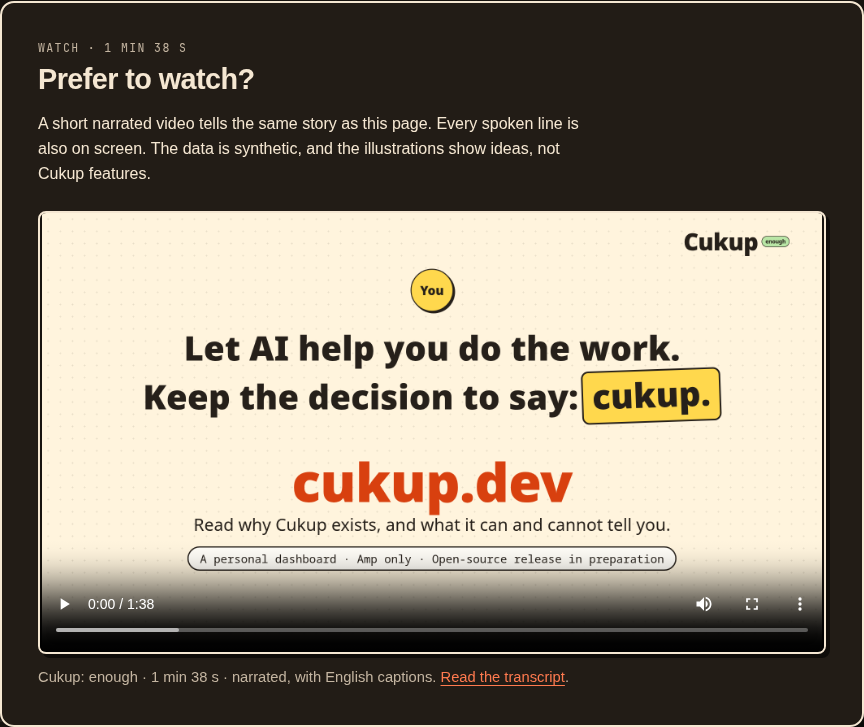
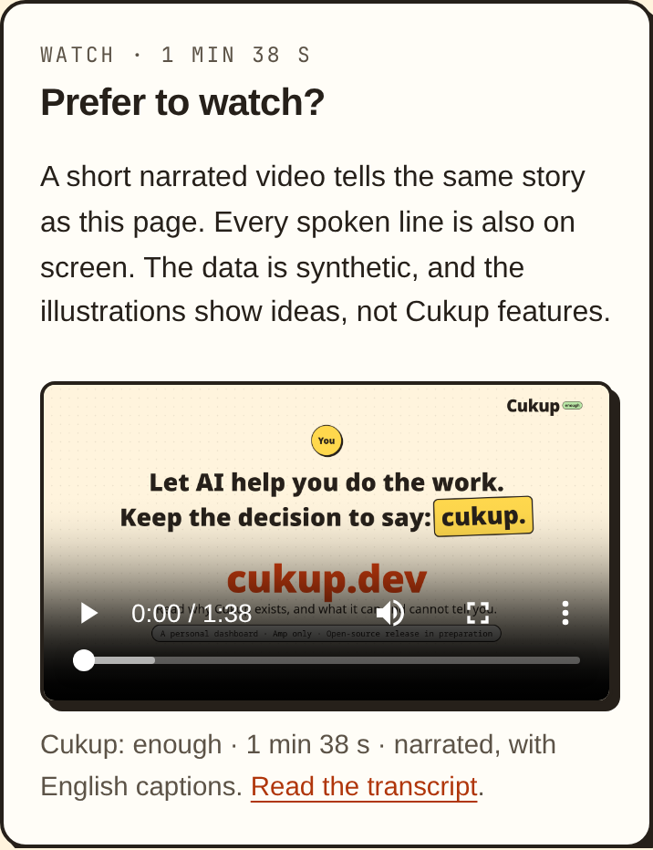
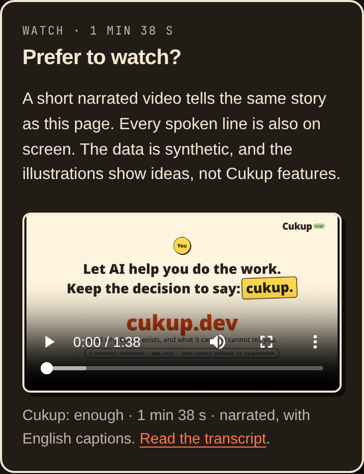
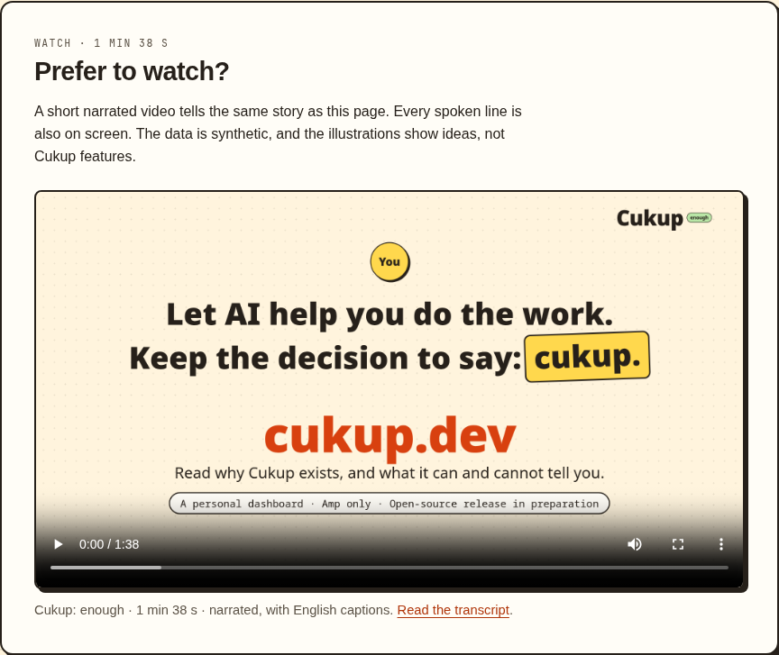
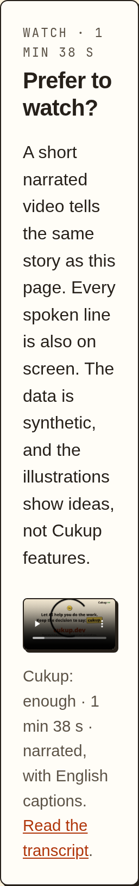
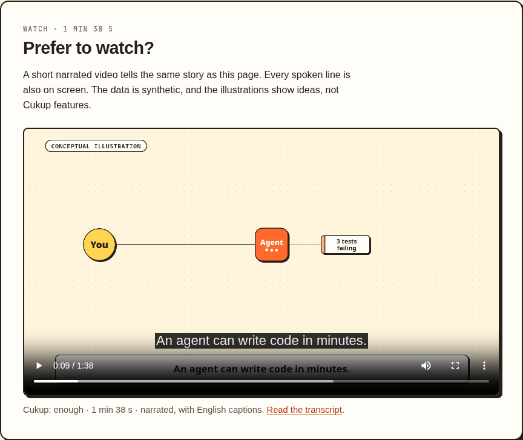
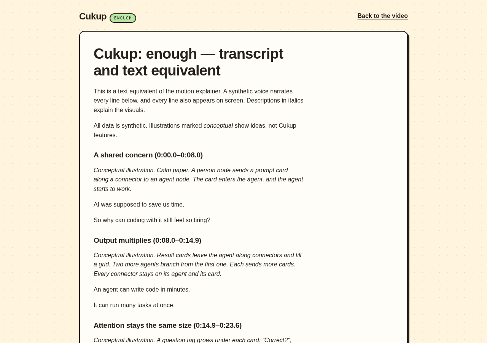

# E2E evidence: explainer on the signed-out page

## Environment

- Candidate: branch `issue-29-motion-explainer`
- Browser: system Chromium 152 through Playwright, headless. No other browser is installed.
- Surface: `bun run service/dashboard/preview.ts`, route `/signed-out`. The preview sends that route, the explainer routes, and the favicon through the real `DashboardBackend`, so headers and CSP match production.
- Checks: [`media/motion-explainer/scripts/verify-landing.ts`](../../../media/motion-explainer/scripts/verify-landing.ts). All 26 checks passed.

## Player

| Check | Result |
| --- | --- |
| Codec support | `canPlayType('video/mp4; codecs="avc1.640028, mp4a.40.2"')` returns `probably` |
| No autoplay | After 3 s the video is paused at 0 s. `autoplay`, `loop`, and `muted` are all false. |
| Poster and metadata | The poster returns 200. With `preload="metadata"`, the duration is known before playback. |
| Play and pause | Playback passes 1.5 s, with decoded audio. After a pause, `currentTime` stays the same for 0.8 s. |
| Seeking | Seeking to 72 s fires `seeked` with `readyState` 4. The browser got three 206 responses, for example `bytes 4521984-6369450/6369451`. |
| Captions | With the English track showing at 9 s, the active cue is “An agent can write code in minutes.” The track is off by default, because the video already shows every line. |
| Transcript | Keyboard Enter on “Read the transcript” opens `/explainer/transcript`, headed “Cukup: enough — transcript and text equivalent”, with no horizontal overflow. |
| Keyboard | Tab reaches the player's native controls and then the transcript link. The focused link has a solid outline. |
| CSP | No `securitypolicyviolation` event and no console error in any run. The page's CSP blocked Playwright's injected style tag, so the 200% text check sets the size through CSSOM instead. |

Headless Chromium refuses unmuted `play()` without a user gesture. The playback run uses `--autoplay-policy=no-user-gesture-required` in place of a click. The no-autoplay check uses a normal launch.

## Layout

| View | Scheme | Result |
| --- | --- | --- |
| 1280 × 900 | light | Paused, 16:9, no horizontal overflow |
| 1280 × 900 | dark | Paused, 16:9, no horizontal overflow |
| 390 × 844 mobile emulation, touch, 2× | light | Paused, 16:9, no horizontal overflow |
| 390 × 844 mobile emulation, touch, 2× | dark | Paused, 16:9, no horizontal overflow |
| 1280 × 900, reduced motion | light | Paused, poster shown, no overflow |
| 320 wide, 200% root text | light | No horizontal overflow |

With the optional caption track turned on:

## Service image

- `bun run build` copies the four files to `dist/service/explainer/`.
- The locally built `Dockerfile.service` image lists them in `/app/explainer`.
- A container from that image served these on the dashboard host:
  - the player, and the CSP with `media-src 'self'`;
  - `206` with `Content-Range: bytes 1000-1999/6369451` for a range request;
  - `200` with `content-length: 6369451` for `HEAD`;
  - a full video byte-identical to `media/motion-explainer/cukup-explainer.mp4`.
- It logged no `explainer_unavailable`.

## Limits

- Chromium only. Firefox and WebKit are not installed, and mobile emulation is not iOS Safari or Android Chrome.
- No screen reader test.
- On mobile, Chromium shows its controls over the paused poster. They cover the invitation and status lines of the end card. The figcaption and the page text still give the same information.
- At 320 px with 200% text, the player is small, like all content in that column. It keeps its 16:9 frame.
- This is a local check. Deployment and live playback are not verified.
