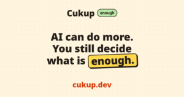

# Evidence: link-preview image and share metadata

## Environment

- Candidate: branch `issue-32-og-image`
- Render: `bun media/og-image/scripts/render.ts`, with system Chromium 152 through Playwright and ImageMagick 7.1.
- Service: `bun run build`, then `dist/service` copied to a temporary directory without the repository's `media/` files. The service ran on loopback with synthetic OAuth settings and an empty database.
- Container: `docker build -f Dockerfile.service`.

## Image

| Check | Result |
| --- | --- |
| Size and format | 1200 × 630, 8-bit palette PNG, 17,432 bytes |
| Reproducible | Two renders give the same SHA-256, `c9c33323…9b83c` |
| Safe area | The render script passes its checks: 80 px side margins, 48 px top and bottom, and the headline inside the center square |
| Guard | With a 76 px headline, the script fails with “The headline is wider than the center square” |
| Fonts | The script refuses to render if a font face does not load |

### Full size, 1200 × 630


### Link card, 600 px wide


### Small card, 300 px wide



The headline and the address stay legible. The “enough” tag is the smallest text, and it is still readable.

### Center-square crop, 200 × 200


Every headline word stays inside the crop. The wordmark tag and the address also stay inside it.

## Built service

| Check | Result |
| --- | --- |
| Image route | `GET /assets/og-image.png` on `cukup.dev` returns 200 with `Content-Type: image/png`, `Content-Length: 17432`, and `Cache-Control: public, max-age=3600` |
| Bytes | The response body matches `media/og-image/og-image.png`, loaded from `dist/service/og-image.png` |
| Headers | `X-Content-Type-Options: nosniff`, `X-Frame-Options: DENY`, and the usual CSP stay. `Cross-Origin-Resource-Policy` is `cross-origin` on this route only. |
| Other hosts | The same path on `api.cukup.dev` returns 404 |
| Start-up | No `social_image_unavailable` log |
| Initial HTML | `curl` of `/` without a session returns the canonical link, Open Graph, and Twitter/X tags below. No script runs. |
| Container | The runtime image has `/app/og-image.png`, 17,432 bytes, with a 1200 × 630 IHDR |

The `<head>` of the signed-out page, one tag per line:

```html
<meta name="description" content="Cukup means “enough” in Indonesian. AI can produce more work, but people still choose, review, and take responsibility. Cukup is a small prompt to pause and consider what is enough.">
<title>Cukup · Decide what is enough</title>
<link rel="canonical" href="https://cukup.dev/">
<meta property="og:type" content="website">
<meta property="og:site_name" content="Cukup">
<meta property="og:title" content="Cukup · Decide what is enough">
<meta property="og:description" content="Cukup means “enough” in Indonesian. AI can produce more work, but people still choose, review, and take responsibility. Cukup is a small prompt to pause and consider what is enough.">
<meta property="og:url" content="https://cukup.dev/">
<meta name="twitter:card" content="summary_large_image">
<meta name="twitter:title" content="Cukup · Decide what is enough">
<meta name="twitter:description" content="Cukup means “enough” in Indonesian. AI can produce more work, but people still choose, review, and take responsibility. Cukup is a small prompt to pause and consider what is enough.">
<meta property="og:image" content="https://cukup.dev/assets/og-image.png">
<meta property="og:image:type" content="image/png">
<meta property="og:image:width" content="1200">
<meta property="og:image:height" content="630">
<meta property="og:image:alt" content="The Cukup wordmark with an “enough” tag above the words “AI can do more. You still decide what is enough.” The word “enough.” is highlighted in yellow. Below it: cukup.dev.">
<meta name="twitter:image" content="https://cukup.dev/assets/og-image.png">
<meta name="twitter:image:alt" content="The Cukup wordmark with an “enough” tag above the words “AI can do more. You still decide what is enough.” The word “enough.” is highlighted in yellow. Below it: cukup.dev.">
```

## Limits

- The previews are local resizes and crops. No real platform preview was checked, because the change is not deployed. After an approved deployment, check the public HTML, the image URL, and a real share preview. Platforms cache previews, so a stale card does not prove a failed deployment.
- `HEAD /` still returns 405, as before. Link-preview crawlers use `GET`. This change does not alter that route's methods.
- The image is light only. Link cards do not follow the viewer's color scheme.
