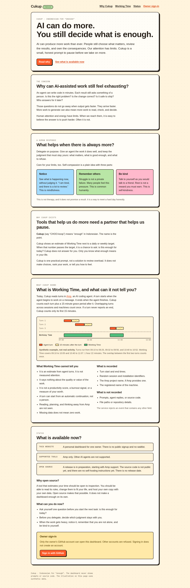
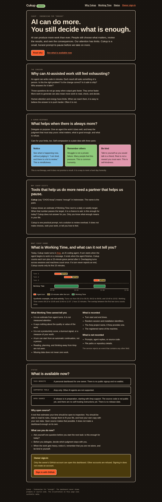
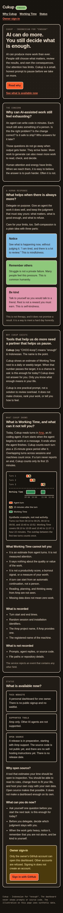
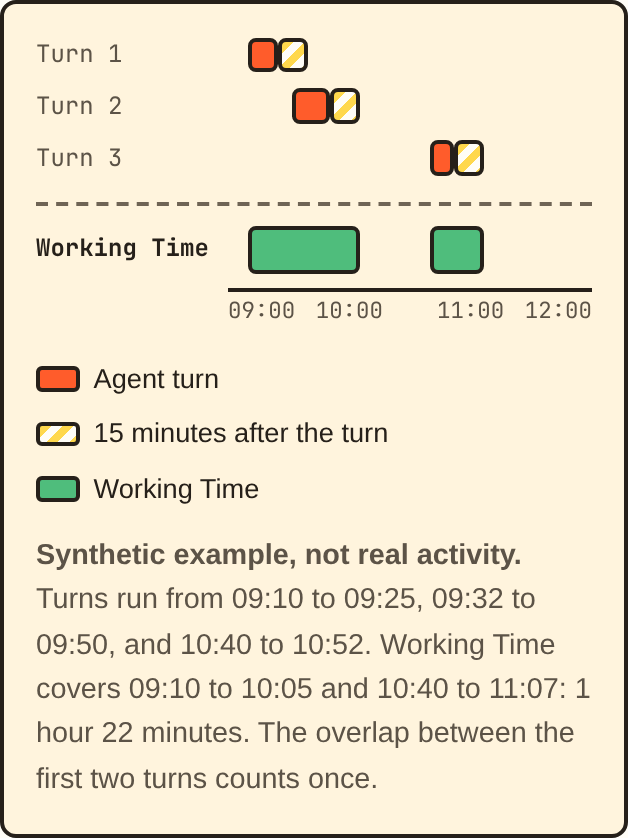

# E2E evidence: public landing page

## Environment

- Candidate: branch `issue-28-public-landing-page`
- Browser: Chromium through Playwright, headless
- Surface: `bun run service/dashboard/preview.ts`, route `/signed-out`, with the bundled dashboard CSS
- Data: none. The page renders no report data. Its illustration is fixed synthetic data.

## Summary

| Viewport | Scheme | Horizontal overflow | Result |
| --- | --- | --- | --- |
| 390 × 900 | light | none (390 = 390) | Pass |
| 390 × 900 | dark | none (390 = 390) | Pass |
| 1280 × 900 | light | none (1280 = 1280) | Pass |
| 1280 × 900 | dark | none (1280 = 1280) | Pass |

- Keyboard order passed. The first Tab shows the skip link. Then focus moves through the page navigation, owner sign-in, hero actions, the Amp link, and **Sign in with GitHub**. Each stop has a 3px solid focus outline.
- Reduced motion passed. The page adds no animation. The shared reduced-motion rule removes button hover movement.
- Headings passed. There is one `h1`, and no level is skipped. The backend test checks this.
- Links passed. Every destination is an in-page anchor, `/auth/github`, a local asset, or `https://ampcode.com/`. The backend test checks this.

## Desktop

## Mobile

The synthetic Working Time illustration at 390px, 2× scale:

## Focus

## Limits

- The test did not use a screen reader or forced-colors mode. In forced colors, the illustration bars keep their borders and lose their fills.
- The test did not measure contrast with a tool. The page uses the existing dashboard color tokens.
- The test did not cover GitHub OAuth or production routing. Backend HTTP tests cover the signed-out response and headers.
