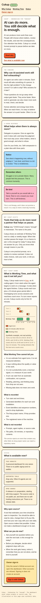
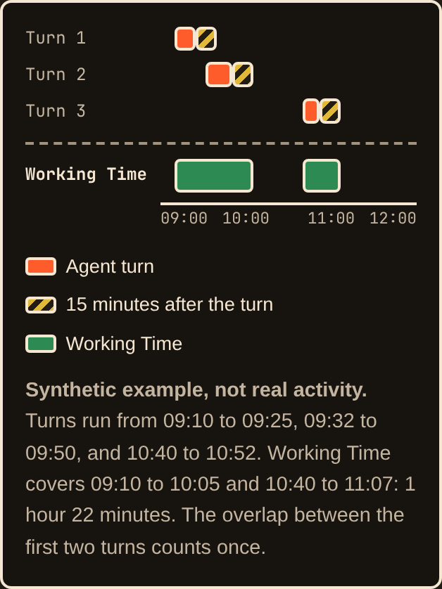
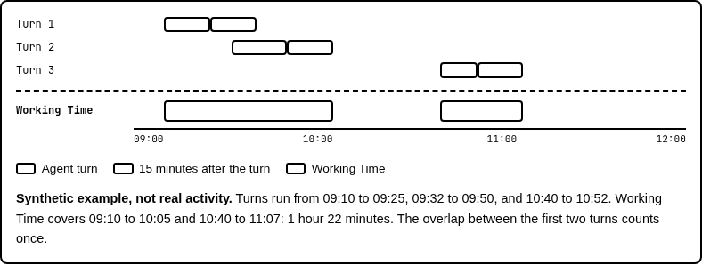
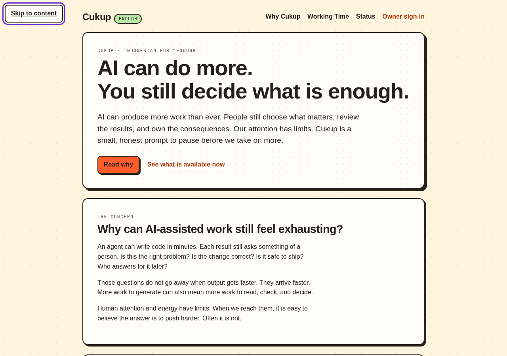
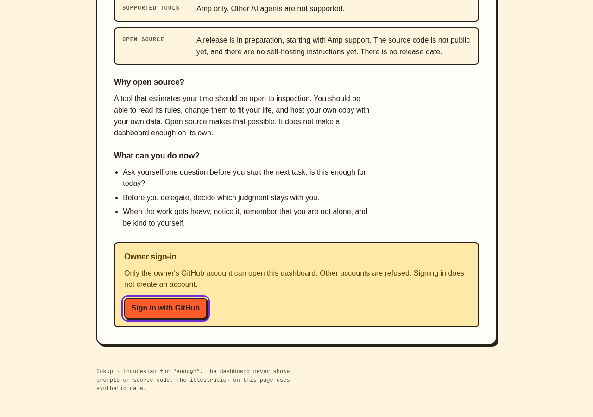

# E2E evidence: public landing page

## Environment

- Candidate: branch `issue-28-public-landing-page`
- Browser: Chromium through Playwright, headless
- Surface: `bun run service/dashboard/preview.ts`, route `/signed-out`, with the bundled dashboard CSS
- Data: none. The page renders no report data. Its illustration is fixed synthetic data.

## Summary

| Viewport | Scheme | Horizontal overflow | Result |
| --- | --- | --- | --- |
| 390 × 900 | light | none (390 = 390) | Pass |
| 390 × 900 | dark | none (390 = 390) | Pass |
| 1280 × 900 | light | none (1280 = 1280) | Pass |
| 1280 × 900 | dark | none (1280 = 1280) | Pass |

- Keyboard order passed. The first Tab shows the skip link. Then focus moves through the page navigation, owner sign-in, hero actions, the Amp link, and **Sign in with GitHub**. Each stop has a 3px solid focus outline.
- Reduced motion passed. The page adds no animation. The shared reduced-motion rule removes button hover movement.
- Headings passed. There is one `h1`, and no level is skipped. The backend test checks this.
- Links passed. Every destination is an in-page anchor, `/auth/github`, a local asset, or `https://ampcode.com/`. The backend test checks this.

## Contrast

Computed text color against the nearest opaque background, at 1280px. Every pair meets 4.5:1.

| Element | Light | Dark |
| --- | --- | --- |
| Body text | 15.83 | 13.84 |
| Prose and secondary links | 6.11 | 6.54 |
| Owner sign-in link (header) | 5.69 | 7.17 |
| Orange buttons | 5.23 | 6.00 |
| Notes and eyebrows | 7.42 | 8.41 |
| Caption, axis, and row labels | 6.91 | 9.21 |
| Self-compassion cards | 10.95 | 9.09 |
| Owner sign-in panel | 7.99 | 9.19 |
| Footer | 6.91 | 9.21 |

The shared light accent measured 4.13–4.43:1 on paper and card, and light button text measured 3.03:1. The page darkens both under `body.landing` only. The authenticated dashboard keeps its tokens.

## Desktop

## Mobile

The synthetic Working Time illustration at 390px, 2× scale:

In forced colors:

## Focus

## Limits

- The test did not use a screen reader.
- In forced colors, the illustration bars keep their borders and lose their fills, so the legend swatches look the same. The caption states the full synthetic data in text.
- The test did not cover GitHub OAuth or production routing. Backend HTTP tests cover the signed-out response and headers.
